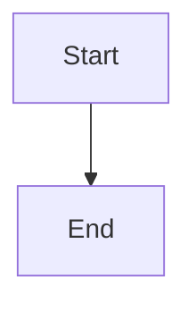

# Mermaid Diagram Troubleshooting Guide

## Quick Debugging Steps

### 1. Check Browser Console
Open your browser's developer console (F12) and look for messages prefixed with `[Mermaid Formatter]`. These will tell you:
- Whether the Mermaid library loaded successfully
- If mermaid code blocks were detected
- Any rendering errors

### 2. Enable Debug Mode
To get more detailed logging, enable debug mode when rendering content:

```javascript
// In MessageNode.vue or wherever FormattedContent is used
const formattedContentOptions = computed(() => ({
  debugMermaid: true, // Enable mermaid debugging
  // ... other options
}));
```

### 3. Verify Syntax
Mermaid diagrams must use the exact syntax:
```

```

Common mistakes:
- ❌ Missing the language identifier: ` ``` ` (without `mermaid`)
- ❌ Wrong casing: ` ```Mermaid ` or ` ```MERMAID ` (should be lowercase)
- ❌ Extra spaces: ` ``` mermaid ` (space before mermaid)
- ❌ Missing closing backticks

### 4. Check Network Tab
1. Open browser DevTools → Network tab
2. Filter by "mermaid" or "js"
3. Reload the page
4. Look for failed requests to `mermaid` module

### 5. Verify Package Installation
Ensure mermaid is installed:
```bash
cd stitch-frontend
npm list mermaid
```

If not installed:
```bash
npm install mermaid
```

### 6. Check Formatter Registration
Verify the mermaid formatter is registered:

```javascript
// In browser console
import { getFormatters } from './components/FormattedContent/formatters';
console.log(getFormatters().map(f => ({ name: f.name, priority: f.priority })));
```

You should see `{ name: 'mermaid', priority: 45 }` in the list.

## Common Issues and Solutions

### Issue: "Mermaid library not available"
**Symptoms:** Error message shows "Mermaid library not available"

**Possible Causes:**
1. Package not installed - Run `npm install mermaid`
2. Build error - Check build output for import errors
3. Module resolution issue - Verify `node_modules/mermaid` exists

**Solution:**
```bash
cd stitch-frontend
npm install mermaid
npm run build  # or npm run dev
```

### Issue: Diagram shows as code block instead of rendered diagram
**Symptoms:** You see the raw mermaid code in a code block

**Possible Causes:**
1. Formatter not registered - Check formatter registration
2. Priority issue - Mermaid formatter (priority 45) should run before code formatter (priority 50)
3. Regex not matching - Check that your syntax exactly matches ` ```mermaid\n...\n``` `

**Solution:**
- Verify the exact syntax (case-sensitive, no extra spaces)
- Check console for `[Mermaid Formatter]` messages
- Verify formatter priority in `init.js`

### Issue: "Diagram syntax error"
**Symptoms:** Error message with mermaid syntax error details

**Possible Causes:**
1. Invalid mermaid syntax
2. Unsupported diagram type
3. Mermaid version compatibility issue

**Solution:**
- Test your diagram syntax at https://mermaid.live/
- Check the error message for specific syntax issues
- Verify mermaid version supports your diagram type

### Issue: Diagram renders but looks wrong
**Symptoms:** Diagram appears but styling/positioning is off

**Possible Causes:**
1. CSS conflicts
2. Theme issues
3. SVG rendering issues

**Solution:**
- Check browser console for CSS errors
- Inspect the rendered SVG element
- Try different mermaid themes in the formatter config

### Issue: Multiple diagrams, some work and some don't
**Symptoms:** Some diagrams render, others show errors

**Possible Causes:**
1. Syntax errors in specific diagrams
2. Race condition in parallel rendering
3. ID conflicts

**Solution:**
- Enable debug mode to see which diagram fails
- Check each diagram individually
- Verify unique diagram IDs are being generated

## Debugging Checklist

- [ ] Browser console shows no errors
- [ ] Mermaid package is installed (`npm list mermaid`)
- [ ] Formatter is registered (check `getFormatters()`)
- [ ] Syntax is exactly ` ```mermaid\n...\n``` ` (case-sensitive)
- [ ] Diagram syntax is valid (test at mermaid.live)
- [ ] Network tab shows mermaid module loading successfully
- [ ] Debug mode enabled and showing detailed logs
- [ ] No CSS conflicts hiding the diagram
- [ ] SVG element is present in DOM (inspect element)

## Testing Your Diagram

Before troubleshooting, verify your diagram syntax works:

1. Go to https://mermaid.live/
2. Paste your mermaid code
3. If it works there but not in the app, it's likely a configuration or integration issue
4. If it doesn't work there either, fix the syntax first

## Getting Help

When reporting issues, include:
1. Browser console output (especially `[Mermaid Formatter]` messages)
2. The exact mermaid code you're trying to render
3. Screenshot of the error (if visible)
4. Browser and version
5. Whether debug mode was enabled
6. Output of `npm list mermaid`
